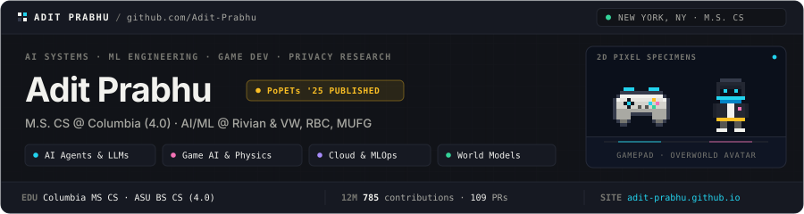
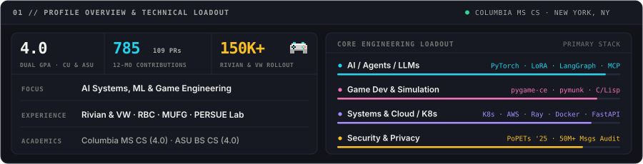

 

 

---

### About

I'm **Adit Prabhu**, an M.S. in Computer Science student at **Columbia University** (ML Track, **4.0/4.0 GPA**, Expected Dec 2026). I build **production ML systems, agentic LLM workflows, physics world models, and retro-inspired games**, previously shipping AI and systems engineering work at **Rivian & Volkswagen Group Technologies**, **RBC Capital Markets**, and **MUFG**.

Before Columbia, I earned my B.S. in Computer Science (**4.0/4.0 GPA**, Dec 2024) from **Arizona State University**, where I conducted security and privacy research in the [**PERSUE Lab**](https://persue-lab-asu.github.io/team/) under Dr. Rakibul Hasan and published in **PoPETs 2025**.

  

---

### Experience

| Role & Organization | Location & Term | Impact Highlights |
| :--- | :--- | :--- |
| **AI/ML Intern**, Rivian & Volkswagen Group Technologies | Palo Alto, CA · May 2026 – Aug 2026 | Shipped an end-to-end smart climate recommender (**+11%** offline Recall@K/Precision@K/accuracy, rolling out to **150,000+ vehicles**), built an EV charge time estimation model (**10.6% MAPE**, **15% relative gain** over production), and adapted an agentic `autoresearch` experimentation loop cutting tuning from months to **under 1 week**. |
| **AI Engineer Intern**, RBC Capital Markets | New York, NY · Jan 2026 – May 2026 | Engineered a deep LLM agent with **10+ specialized tools** (scenario PnL, leveraged credit, VaR) cutting turnaround **80%**, optimized orchestration via inference caching & dynamic routing (**-65% latency, -40% LLM cost**), and built hybrid RAG across **15+ risk workflows on 4+ desks** (**+25% reasoning accuracy**). |
| **Software Engineer (Intern → Full-Time)**, MUFG | Tempe, AZ · Jun 2024 – Aug 2025 | Built anomaly detection & validation services covering **500+ employees** (**+23%** reporting accuracy), shipped Python microservices automating audit workflows across **3+ regions** (uncovering 4+ control gaps), and tuned SQL/batch jobs from **7+ hrs → under 30 min** (**+17%** data accuracy). |
| **Research Assistant**, PERSUE Lab, ASU | Tempe, AZ · Aug 2023 – Jun 2024 | Built the PII-detection ML pipeline and **Swift/Kotlin** instrumentation analyzing **50M+ messages across 3,000+ Zoom Marketplace apps** for the **PoPETs 2025** privacy audit. |

---

### Selected Projects

| Project | Domain | Summary & Links | Stack |
| :--- | :--- | :--- | :--- |
| **[Overload](https://github.com/Adit-Prabhu/overload)** | Game AI / Action | 256×144 pixel-art top-down shooter (Columbia COMS E6998 final project): 3-sector campaign, 3 three-phase Regulator bosses, 5 evolvable base powers + 30 chance-fused powers, original soundtrack + 81 SFX, and a Cloudflare Worker adaptive rival backed by Vertex AI with strict Evidence v4 schema & deterministic fallback. | `Python` `pygame-ce` `TypeScript` `Cloudflare Workers` `Vertex AI` `Zod` |
| **[Abuse (1996) Remake](https://github.com/Adit-Prabhu/abuse_remake)** | Game Engine / Agent Eval | Faithful 15 Hz Level 1 reconstruction from the original C engine, Common Lisp rules, and level files (COMS E6998 midterm), paired with a 5-op JSONL agent interface benchmarking an LLM player vs. scripted search. [**Watch Demo ↗**](https://youtu.be/Sv1Ex4Y5H7M) | `Python` `pygame-ce` `C/C++` `Common Lisp` `LLM SDKs` |
| **[Foresight Worlds](https://github.com/amaan784/foresight-worlds)** | Physics World Models | Built at the Gemini 4 NYC Hackathon (Nov 2026): lifts 3 seconds of real video into a fitted `pymunk` physics simulation to predict the next 5 seconds of object trajectories for robotics & Physics-IQ evaluation. [**Watch Demo ↗**](https://youtu.be/uZtcHMUKOVQ) | `Python` `FastAPI` `pymunk` `Gemini` `Vite` `TypeScript` |
| **[Dynamic NPC Ecosystem](https://github.com/Adit-Prabhu/Dynamic_NPC_Ecosystem)** | Multi-Agent Simulation | Autonomous multi-agent NPC sandbox: fine-tuned **LLaMA 3.1 8B** via **QLoRA (4-bit)** generating internal monologue + dialogue in a single forward pass, paired with **NetworkX GraphRAG** memory over 100s of entities, Chain-of-Thought (*"Thought Bubble"*) inspection, and viral rumor propagation. | `Python` `LLaMA 3.1` `QLoRA` `NetworkX GraphRAG` `FastAPI` `React / TS` |
| **[AdBlocker RPG](https://github.com/Adit-Prabhu/AdBlocker-RPG)** | Browser Extension / Game | Chrome Extension (Manifest V3) that turns web ads and trackers into tiered monsters (*Tracker-Spider → Fullscreen-Hydra*) with click combat, XP/Gold progression, and a persistent local backend. | `JavaScript` `Chrome MV3` `CSS` `Python` `Flask` |
| **[Kubernetes Self-Healing Agent](https://github.com/sreeram0407/amlc-k8s-self-healing-agent)** | Cloud / Autonomous SRE | Columbia AMLC Spring 2026: autonomous GKE/K8s pod diagnosis and guardrail-gated remediation via 10 MCP tools, authoring the `SKILL.md` runbook, 2-tier Claude model routing (Haiku 4.5 / Sonnet 4.6), and Slack escalation templates. | `Python` `Claude API` `MCP` `GKE / Kubernetes` `SQLite` `Slack` |
| **[Dream Camera](https://github.com/Adit-Prabhu/DreamCamera)** | Multimodal RAG | Local-first multimodal photo library supporting semantic search by vibe/mood or reference image (with GPS & date filters) plus visual, temporal, and hybrid AI album clustering & naming. | `Python` `CLIP` `BLIP` `ChromaDB` `Streamlit` `React / TS` |
| **[BillCheck / MedClear](https://github.com/krishrveera/MedClear)** | Healthcare Verification | Deterministic, auditable medical billing verification engine backed by CMS Medicare Fee Schedule, NCCI, ICD-10, and FDA tables producing dollar-quantified discrepancy reports. | `Python` `FastAPI` `OAuth 2.0` `CMS / NCCI / ICD-10` |

<strong>Additional Public Projects & Contributions</strong>

- **[Sentinel AI](https://github.com/amanupg/sentry-project)**: Multi-agent Neo4j + Next.js 14 + ElevenLabs accountability investigator.
- **[Motivation Atlas: "Dragon's Hoard"](https://github.com/columbia-university-ai-games/motivation-atlas)**: Contributed the *Dragon's Hoard* chance minigame to Columbia AI Games' interactive motivation explorer.
- **[Deep Stock](https://github.com/Adit-Prabhu/deep-stock)**: Hybrid CNN + LSTM + market-sentiment stock predictor combining price chart images, time-series features, and sentiment analysis (Test MAE `0.0508`).
- **[Automated Counter](https://github.com/automated-street-environment-detection/automated-counter)**: OpenCV/Tkinter computer-vision street traffic video counter.

---

### Published Research

> **Who's Watching You Zoom? Investigating Privacy of Third-Party Zoom Apps**
> Saharsh Goenka, **Adit Prabhu**, Payge Sakurai, Mrinaal Ramachandran, Rakibul Hasan *(PERSUE Lab, ASU)*
> **Proceedings on Privacy Enhancing Technologies (PoPETs) 2025, Issue 4, pp. 530–548** · DOI: `10.56553/popets-2025-0143`
>
> A one-year longitudinal audit of **50M+ messages across 3,000+ third-party Zoom Marketplace apps** using a custom PII-detection ML pipeline and Swift/Kotlin instrumentation to investigate data over-collection, privacy policy transparency, and potential compliance gaps.
>
> 
> 

---

### Tech Stack

**ML, Deep Learning & LLM Systems**

**MLOps, Cloud, Game Dev & Web**

**Languages & Data**

---

### Contact

- **Interactive Portfolio:** [adit-prabhu.github.io](https://adit-prabhu.github.io/)
- **Email:** [ap4806@columbia.edu](mailto:ap4806@columbia.edu)
- **LinkedIn:** [linkedin.com/in/adit-prabhu](https://www.linkedin.com/in/adit-prabhu)
- **GitHub:** [github.com/Adit-Prabhu](https://github.com/Adit-Prabhu)
